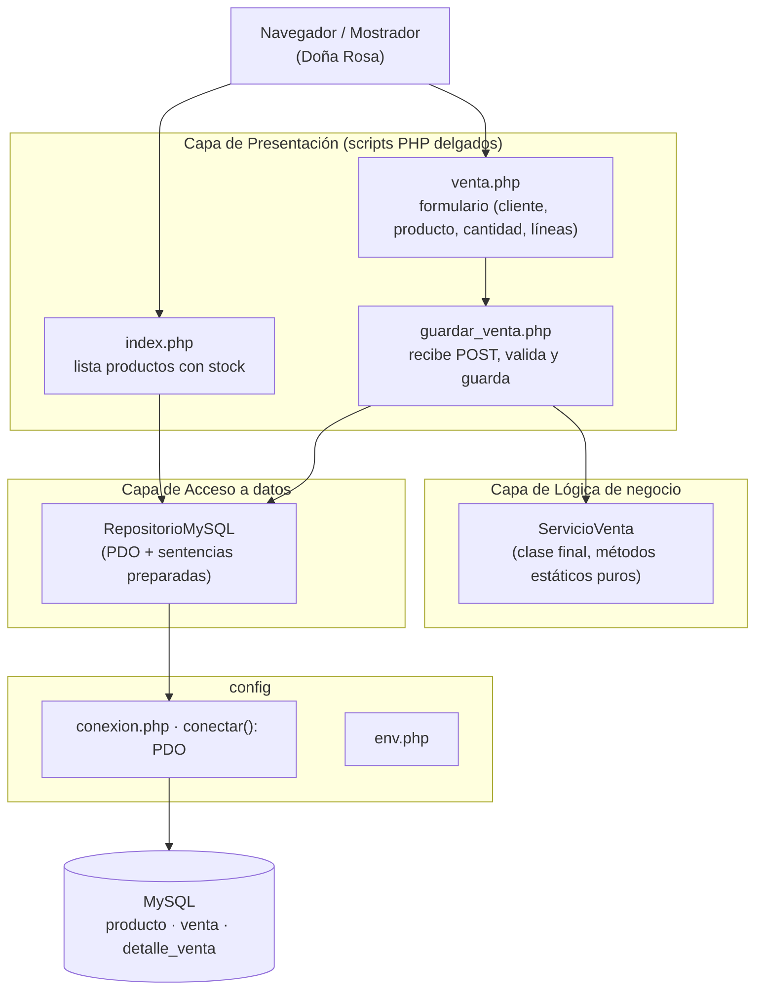
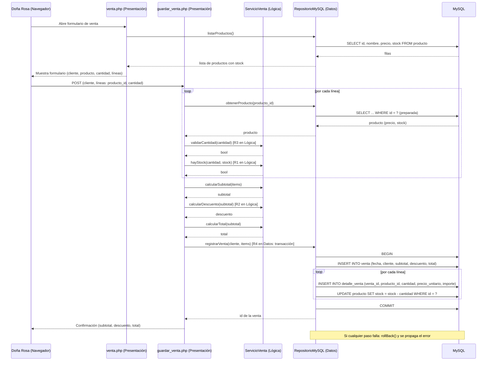

# Design Document — Registro de Ventas Bodega «Doña Rosa»

## Overview

El Sistema Bodega es una aplicación PHP 8 + MySQL (sobre XAMPP) que reemplaza el cuaderno de papel de la bodega de Doña Rosa en San Vicente de Cañete. Permite registrar productos con su stock, registrar ventas de una o varias líneas, descontar el stock vendido en la misma transacción y aplicar un descuento por volumen del 5 % cuando el subtotal supera S/ 100.00.

Esta versión **excluye** autenticación de usuarios y reportes. La única usuaria es Doña Rosa desde la computadora del mostrador.

El diseño sigue una **arquitectura de tres capas** sin framework y sin librerías externas (salvo PHPUnit para pruebas), alineado con las restricciones de `D0.md`:

- **Presentación**: scripts PHP delgados (`index.php`, `venta.php`, `guardar_venta.php`).
- **Lógica de negocio**: una sola clase `ServicioVenta` con métodos estáticos puros (sin HTML, sin SQL, sin PDO, sin `echo`, sin acceso a base de datos).
- **Acceso a datos**: una sola clase `RepositorioMySQL` con PDO y sentencias preparadas.

Decisiones clave de diseño:

- **Tres capas, no cuatro**: no hay modelos de dominio ni repositorios separados por entidad; la lógica de negocio vive en una sola clase pura y el acceso a datos en una sola clase.
- **`ServicioVenta` puro y estático**: las reglas R3 (cantidad), R1 (stock) y R2 (descuento) se evalúan aquí, sin dependencias externas, lo que las hace testeables con unit tests sin base de datos.
- **Dinero en `float` con `round(x, 2)`**: coherente con las firmas `float` de `ServicioVenta` y con `assertEqualsWithDelta` en las pruebas; se cuida el borde exacto `S/ 100.00` (sin descuento).
- **Transacción en `RepositorioMySQL::registrarVenta`** (R4): inserta la venta y sus líneas y descuenta el stock atómicamente.

## Architecture



### Capas y responsabilidades

| Capa | Archivos | Responsabilidad | Reglas |
|---|---|---|---|
| Presentación | `index.php`, `venta.php`, `guardar_venta.php` | Capturar entradas, llamar al servicio/repositorio, mostrar resultados/errores. Sin lógica de negocio. | — |
| Lógica de negocio | `src/ServicioVenta.php` | Validaciones y cálculos puros. Sin HTML, SQL, PDO, `echo` ni BD. | R3, R1, R2 |
| Acceso a datos | `src/RepositorioMySQL.php` | PDO con sentencias preparadas; listar, obtener y persistir. | R4 (transacción) |
| Config | `config/conexion.php`, `config/env.php` | `conectar(): PDO` y credenciales. | — |

### Flujo de registro de venta (qué capa valida cada regla)



### Eliminaciones respecto a la versión anterior

Se elimina la arquitectura de cuatro capas previa. Concretamente **no existen**: `ServicioProducto`, `RepositorioProducto`, `RepositorioVenta`, `ConexionBD`, los modelos `Producto`/`LineaVenta`/`Venta`, el autoloader y los scripts `productos.php`/`ventas.php`/`stock.php`. Tampoco se usa composer ni autoloader; `guardar_venta.php` incluye directamente `src/ServicioVenta.php` y `src/RepositorioMySQL.php` con `require`.

## Components and Interfaces

### `ServicioVenta` — lógica de negocio (`src/ServicioVenta.php`)

Clase `final` con métodos **estáticos** y **puros**: sin HTML, sin SQL, sin PDO, sin `echo`, sin acceso a base de datos.

| Método | Firma | Regla | Descripción |
|---|---|---|---|
| `validarCantidad` | `(int $cantidad): bool` | R3 | Devuelve `true` si la cantidad es un entero `> 0`. |
| `hayStock` | `(int $cantidad, int $stock): bool` | R1 | Devuelve `true` si `cantidad <= stock` (incluye el caso `cantidad == stock`). |
| `calcularSubtotal` | `(array $items): float` | — | Suma `precio_unitario × cantidad` de cada línea, con `round(..., 2)`. `$items` es un arreglo de líneas con claves `precio_unitario` y `cantidad`. |
| `calcularDescuento` | `(float $subtotal): float` | R2 | `round(subtotal × 0.05, 2)` si `subtotal > 100.00`; `0.0` en caso contrario (el exacto `100.00` no descuenta). |
| `calcularTotal` | `(float $subtotal): float` | — | `round(subtotal − calcularDescuento(subtotal), 2)`. |

Firma de la clase:

```php
<?php
final class ServicioVenta
{
    public static function validarCantidad(int $cantidad): bool { /* cantidad > 0 */ }
    public static function hayStock(int $cantidad, int $stock): bool { /* cantidad <= stock */ }
    public static function calcularSubtotal(array $items): float { /* Σ precio × cantidad, round 2 */ }
    public static function calcularDescuento(float $subtotal): float { /* 5% si > 100.00 */ }
    public static function calcularTotal(float $subtotal): float { /* subtotal − descuento */ }
}
```

`calcularTotal` recibe sólo `$subtotal` y recalcula el descuento internamente con `self::calcularDescuento($subtotal)`, de modo que el total siempre coincide con `subtotal − descuento`.

### `RepositorioMySQL` — acceso a datos (`src/RepositorioMySQL.php`)

Una sola clase con PDO y sentencias preparadas.

| Método | Firma | Descripción |
|---|---|---|
| `listarProductos` | `(): array` | `SELECT id, nombre, precio, stock FROM producto ORDER BY nombre`. Devuelve filas asociativas. |
| `obtenerProducto` | `(int $id): ?array` | `SELECT ... WHERE id = ?` preparada. Devuelve la fila o `null`. |
| `registrarVenta` | `($cliente, $items): int` | Transacción (R4): inserta `venta`, inserta cada `detalle_venta` y descuenta stock con `UPDATE producto SET stock = stock - ?`. Devuelve el id de la venta. Ante fallo hace `rollBack()`. |

`$items` en `registrarVenta` es un arreglo que lleva las líneas y los totales calculados por `ServicioVenta` (mantiene la firma `registrarVenta($cliente, $items)` con un solo parámetro de datos):

```php
$items = [
    'subtotal'  => $subtotal,   // float, calculado por ServicioVenta::calcularSubtotal
    'descuento' => $descuento,   // float, calculado por ServicioVenta::calcularDescuento  (R2)
    'total'     => $total,       // float, calculado por ServicioVenta::calcularTotal
    'lineas'    => [
        ['producto_id' => 1, 'cantidad' => 2, 'precio_unitario' => 10.00, 'importe' => 20.00],
        // ...
    ],
];
```

El `precio_unitario` de cada línea es el **snapshot** del precio vigente al vender (tomado de `obtenerProducto`), de modo que un cambio de precio posterior no altera el subtotal histórico.

### `config/conexion.php` y `config/env.php`

- `config/env.php` (ignorado por git) define host, base de datos, usuario y contraseña.
- `config/conexion.php` expone `conectar(): PDO` que lee `env.php` y devuelve una `PDO` MySQL con `PDO::ERRMODE_EXCEPTION`.

### Scripts de presentación

| Script | Acción | Usa |
|---|---|---|
| `index.php` | Lista los productos con nombre y stock actual (incluye los de stock cero). | `RepositorioMySQL::listarProductos()` |
| `venta.php` | Formulario con `cliente`, y varias líneas (`producto`, `cantidad`). | `RepositorioMySQL::listarProductos()` |
| `guardar_venta.php` | Recibe el POST, obtiene el stock con `RepositorioMySQL`, valida y calcula con `ServicioVenta`, y guarda con `RepositorioMySQL::registrarVenta`. | `ServicioVenta` + `RepositorioMySQL` |

Los scripts sólo capturan entradas, llaman a la lógica/repositorio y muestran resultados o errores. No contienen lógica de negocio.

## Data Models

### Esquema MySQL (nombres y tipos exactos)

#### `producto`
| Columna | Tipo | Restricciones |
|---|---|---|
| `id` | `INT` | `PRIMARY KEY AUTO_INCREMENT` |
| `nombre` | `VARCHAR(80)` | `NOT NULL` |
| `precio` | `DECIMAL(8,2)` | `NOT NULL` |
| `stock` | `INT` | `NOT NULL DEFAULT 0` |

#### `venta`
| Columna | Tipo | Restricciones |
|---|---|---|
| `id` | `INT` | `PRIMARY KEY AUTO_INCREMENT` |
| `fecha` | `DATETIME` | `NOT NULL DEFAULT CURRENT_TIMESTAMP` |
| `cliente` | `VARCHAR(80)` | `NOT NULL` |
| `subtotal` | `DECIMAL(10,2)` | `NOT NULL` |
| `descuento` | `DECIMAL(10,2)` | `NOT NULL DEFAULT 0` |
| `total` | `DECIMAL(10,2)` | `NOT NULL` |

#### `detalle_venta`
| Columna | Tipo | Restricciones |
|---|---|---|
| `id` | `INT` | `PRIMARY KEY AUTO_INCREMENT` |
| `venta_id` | `INT` | `NOT NULL`, `FK → venta(id) ON DELETE CASCADE` |
| `producto_id` | `INT` | `NOT NULL`, `FK → producto(id)` |
| `cantidad` | `INT` | `NOT NULL` |
| `precio_unitario` | `DECIMAL(8,2)` | `NOT NULL` (snapshot del precio al vender) |
| `importe` | `DECIMAL(10,2)` | `NOT NULL` (`precio_unitario × cantidad`) |

```mermaid
erDiagram
    producto ||--o{ detalle_venta : "aparece en"
    venta ||--o{ detalle_venta : "contiene"
    producto {
        int id PK
        varchar(80) nombre
        decimal(8,2) precio
        int stock
    }
    venta {
        int id PK
        datetime fecha
        varchar(80) cliente
        decimal(10,2) subtotal
        decimal(10,2) descuento
        decimal(10,2) total
    }
    detalle_venta {
        int id PK
        int venta_id FK
        int producto_id FK
        int cantidad
        decimal(8,2) precio_unitario
        decimal(10,2) importe
    }
```

### Manejo de dinero (decisión de diseño)

Los cálculos monetarios se hacen con **`float` y `round(x, 2)`**, **no bcmath**. Esto es coherente con las firmas `float` de `ServicioVenta` y con `assertEqualsWithDelta` en las pruebas (que compara con una tolerancia delta en lugar de igualdad estricta).

Borde exacto de R2: la comparación `subtotal > 100.00` es estricta, de modo que el caso `subtotal == 100.00` no aplica descuento. `calcularSubtotal` devuelve `round(..., 2)`, por lo que el subtotal que recibe `calcularDescuento` ya está redondeado a dos decimales; así el `100.00` exacto se evalúa sin activar el descuento por error.

## Error Handling

### Estrategia general

- **Errores de validación (R3, R1):** `ServicioVenta::validarCantidad` y `ServicioVenta::hayStock` devuelven `bool`. `guardar_venta.php` recorre las líneas, recopila los errores y los muestra al usuario. No se lanzan excepciones desde el servicio; la presentación decide qué mostrar.
- **Errores de persistencia:** `RepositorioMySQL::registrarVenta` envuelve la transacción en `try/catch (PDOException)`; ante fallo hace `rollBack()` y vuelve a lanzar. La presentación captura y muestra un mensaje genérico.
- **Transacción de venta (R4):** `registrarVenta` abre la transacción; cualquier fallo (inserción o `UPDATE` de stock) provoca `rollBack()` antes de propagarse. No queda stock descontado a medias ni una venta parcial persistida.

### Mensajes de error

| Condición | Mensaje | Regla |
|---|---|---|
| Cantidad cero, negativa o decimal | `La cantidad debe ser un entero mayor que cero.` | R3 |
| Cantidad mayor al stock | `Stock insuficiente para el producto «{nombre}».` | R1 |
| Error de base de datos | `No se pudo completar la operación. Intente de nuevo.` | R4 |

## Testing Strategy

### Por qué no se usa property-based testing

La restricción de `D0.md` es «sin librerías externas salvo PHPUnit», y PHPUnit no es una librería de property-based testing. Además las reglas de negocio (R1, R2, R3) son comparaciones y cálculos simples sobre valores límite, que se cubren mejor con **unit tests de valores límite** que con propiedades universales aleatorizadas. Por ello **se omite la sección de Correctness Properties** y la estrategia se basa en unit tests de ejemplo (valores límite) sin base de datos.

### Unit tests (PHPUnit) — lógica pura de `ServicioVenta`

Sólo se prueban los métodos de `ServicioVenta` (R1, R2, R3). **Sin base de datos**, **sin pruebas de integración**, **sin `env.test.php`**. `phpunit.xml` usa `bootstrap="src/ServicioVenta.php"`.

**`validarCantidad` (R3):**
- `0` → `false`.
- `-1` → `false`.
- Entero `> 0` (ej. `1`, `5`) → `true`.

**`hayStock` (R1):**
- `cantidad > stock` (ej. `5` vs `3`) → `false`.
- `cantidad == stock` (ej. `3` vs `3`) → `true` (la venta es válida y el stock queda `0`).
- `cantidad < stock` (ej. `2` vs `3`) → `true`.

**`calcularDescuento` / `calcularTotal` (R2):**
- `subtotal > 100.00` (ej. `150.00`) → descuento `7.50`, total `142.50`.
- `subtotal == 100.00` exacto → descuento `0.00`, total `100.00`.
- `subtotal < 100.00` (ej. `99.99`) → descuento `0.00`, total `99.99`.

Las aserciones de dinero usan `assertEqualsWithDelta($esperado, $real, 0.01)` para tolerar el redondeo de `float`.

### Cobertura de aceptancia → pruebas

| Criterio | Tipo | Prueba |
|---|---|---|
| 2.2 rechazar cantidad inválida (R3) | Unit | `validarCantidad`: `0`, `-1` → `false` |
| 2.3 rechazar cantidad > stock (R1) | Unit | `hayStock`: `5` vs `3` → `false` |
| 2.4 cantidad == stock → válido (R1) | Unit | `hayStock`: `3` vs `3` → `true` |
| 4.1 descuento > 100 (R2) | Unit | `calcularDescuento(150.00)` → `7.50` |
| 4.2 descuento == 100 → 0 (R2) | Unit | `calcularDescuento(100.00)` → `0.00` |

### Pruebas excluidas

- **Sin pruebas de integración**: no se prueba `RepositorioMySQL` contra MySQL.
- **Sin `env.test.php`**: no hay base de datos de prueba.
- **Sin property-based testing**: no se usa librería de PBT.

## Decisiones de diseño y su justificación

- **Tres capas, no cuatro:** elimina modelos de dominio y repositorios por entidad; la lógica pura vive en una sola clase testeable sin BD y el acceso a datos en una sola clase.
- **`ServicioVenta` estática y pura:** R3, R1 y R2 se evalúan sin dependencias, lo que permite probarlas con unit tests sin base de datos.
- **Dinero en `float` + `round(x, 2)`:** coherente con las firmas `float` y con `assertEqualsWithDelta`; el borde `100.00` se cuida con comparación estricta `>`.
- **Transacción en `RepositorioMySQL::registrarVenta`** (R4): atomicidad del descuento de stock junto con la inserción de la venta y sus líneas.
- **Sin autoloader ni composer:** `guardar_venta.php` incluye directamente las dos clases con `require`, cumpliendo la restricción de no usar librerías externas.
